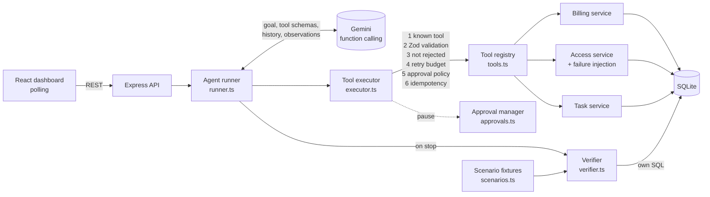

# SagaPilot — Autonomous Multi-System Enterprise Operator

SagaPilot is a small AI employee. You give it a business objective in plain English. It then operates three simulated company systems (**Billing**, **Access Management**, **Task Management**) through real, database-backed tools. When something fails, it recovers. When company policy requires it, it waits for a human. When it finishes, a separate verifier checks the outcome against the database.

```
Goal → Understand → Plan → Execute → Observe → Adapt → Verify → Complete
```

Google Gemini (function calling) decides every action. The application decides what is **allowed** and what counts as **done**.

---

## 1. Problem statement

Real business operations span several systems. Upgrading a customer means changing billing, provisioning access, and handing work to a team. Each step can fail independently: an API returns 503, or a precondition (an active workspace) isn't met. A useful autonomous operator must:

- choose the right actions from a goal rather than follow a hard-coded script,
- react sensibly to partial failures instead of blindly retrying or giving up,
- respect non-negotiable company rules (approvals) that the AI cannot override, and
- never report success it cannot prove.

SagaPilot is an MVP of that loop, built to be easy to read and explain.

## 2. Features

- **Custom agent runtime** (no LangChain): a model adapter, tool registry, guarded tool executor, approval manager, run/trace repository, and an independent verifier.
- **11 typed tools** over three systems, with every argument validated by Zod. There is no SQL, shell, filesystem or HTTP tool.
- **Failure injection** in the simulated environment: a one-time `503` and a "workspace suspended" precondition failure.
- **Human-in-the-loop approval** for downgrades (deterministic rule). The action is persisted, the run pauses, and it resumes after a decision. Rejected actions never execute.
- **Idempotency keys, retry caps, step limit, time budget, model-call timeout**, and infrastructure backoff for Gemini 429/5xx errors.
- **Independent verifier** that runs its own SQL against the final state, with per-check pass/fail results.
- **React dashboard** showing the live trace of real tool calls (sensitive fields redacted), the approval card, the state of all three systems, failure-injection controls and the verification report.
- **Deterministic reset** to the same synthetic seed data.

## 3. Architecture



### The agent loop (`server/agent/runner.ts`)

1. The run starts with one user message: `Objective: <goal>`, plus a generic system instruction and the JSON schemas of all tools.
2. Gemini returns one or more `functionCall`s (or plain text when it considers itself done).
3. Each call goes through the **tool executor**, which applies the deterministic guards and then runs the real service function.
4. Each real result (success **or** structured error such as `{code: "SERVICE_UNAVAILABLE", retryable: true}`) goes back to Gemini as a `functionResponse` matched to its call id. The model's own turn is appended to the history **unchanged**, which preserves Gemini 3 thought signatures across steps.
5. If a call needs approval, the run state (history plus the partially built function responses) is saved to SQLite and the status becomes `awaiting_approval`. A human decision fills in that response and resumes the loop.
6. When Gemini replies without tool calls, the **verifier** checks the database and sets the final status.

Limits: 24 model turns per run, 5-minute time budget (excluding approval waits), 90 s per model call, and 3 failed attempts of the same action per run.

### Folder structure

```
server/
  index.ts, app.ts, config.ts       Express entry, routes, env loading
  db/database.ts, db/seed.ts        SQLite schema; deterministic seed and reset
  systems/
    billing/  access/  tasks/       service.ts (logic) + routes.ts (read-only REST)
    rules.ts                        company rules shown to the agent
    failures.ts                     failure injection (simulated environment)
    errors.ts                       ServiceError (HTTP-like status + code)
  agent/
    runner.ts                       the agent loop
    model.ts, gemini.ts             model interface + official @google/genai adapter
    tools.ts                        tool registry (Zod schemas + implementations)
    executor.ts                     guarded tool execution
    approvals.ts                    approval policy + approval records
    runStore.ts                     runs, history, trace events
    prompt.ts, redact.ts            system instruction; redaction and signatures
  scenarios/scenarios.ts            demo goals + expected final state (verifier only)
  verification/verifier.ts          independent outcome checks
  scripts/gemini-smoke.ts           connectivity + function-calling smoke test
  scripts/live-run.ts               CLI live run with full trace output
client/src/                         React dashboard (Vite)
tests/                              Vitest unit tests (FakeModelAdapter for the loop)
docs/live-runs/                     raw logs of real Gemini runs
```

## 4. Tech stack

TypeScript · Node.js 22 · Express 5 · SQLite via `better-sqlite3` · Google Gemini via the official `@google/genai` SDK (`generateContent` with `functionDeclarations` and `parametersJsonSchema`) · Zod 4 (validation and JSON Schema generation) · React 19 + Vite · Vitest · `tsx` for running TypeScript.

## 5. Local setup

Requires Node.js ≥ 20.12 (developed on 22.19).

```bash
npm install
```

```bash
cp .env.example .env
```

Put your key in `.env`, then check that the configured model works with function calling:

```bash
npm run gemini:smoke
```

Start the API (port 3001) and the dashboard (port 5173) together:

```bash
npm run dev
```

Open http://localhost:5173. The SQLite database is created and seeded automatically in `data/sagapilot.db`.

Other commands:

```bash
npm test
```

```bash
npm run typecheck
```

```bash
npm run build
```

`npm run build` puts the dashboard in `dist/client`; `npm start` then serves the API and the built dashboard on port 3001.

> **Note:** On the development machine, `registry.npmjs.org` failed TLS handshakes, so the dependencies were installed through `registry.yarnpkg.com`, a mirror of the same registry. As a result, `package-lock.json` resolves to that host. `npm install` works with either registry, and integrity hashes are identical.

## 6. Environment variables

| Variable | Purpose | Default |
|---|---|---|
| `GEMINI_API_KEY` | Gemini API key. Read only on the server; never logged or sent to the browser. | none (the agent is disabled and the dashboard shows why) |
| `GEMINI_MODEL` | Any Gemini model that supports function calling. `npm run gemini:smoke` lists the models your key can use. | `gemini-3.1-flash-lite` |
| `PORT` | API port. | `3001` |
| `SAGAPILOT_DB` | Optional path to the SQLite file. | `data/sagapilot.db` |

`gemini-2.5-flash` was the original choice. For this key the API answers `404 … no longer available to new users`, so it was replaced after checking availability with the smoke test (see §11).

## 7. Running the scenarios

**Dashboard:** click **Reset demo data**, choose a scenario button, optionally arm a failure, then click **Run agent**.

| | Scenario A — Upgrade | Scenario B — Downgrade |
|---|---|---|
| Goal | "Upgrade Acme Corp to Enterprise, enable the appropriate premium access, and create the required onboarding task." | "Downgrade Beacon Labs to Starter, remove access no longer allowed under that plan, and create a transition task." |
| Seed state | Acme: Growth, 3 features | Beacon: Enterprise, all 6 features |
| Approval | none | downgrade pauses for approval |

**CLI (prints the full trace and uses its own database file):**

```bash
npm run live:run -- upgrade --fail transient_503
```

```bash
npm run live:run -- upgrade --fail workspace_suspended
```

```bash
npm run live:run -- downgrade --approve
```

```bash
npm run live:run -- downgrade --reject
```

In the CLI, `--approve`/`--reject` stand in for the human reviewer. All agent decisions still come from Gemini.

You can also type any other goal in the dashboard. It runs with the same agent, but the result is reported as **Completed (not verifiable)**, because no acceptance conditions exist for it.

## 8. Failure injection

Failures belong to the **simulated environment**, not to the agent. An operator arms one (dashboard or `POST /api/failures`). It is stored in the `failure_injections` table, and `setEntitlements()` in the access service consumes it the next time provisioning runs:

| Kind | What the system does | What the agent sees |
|---|---|---|
| `transient_503` | Fails once and applies no changes. | `SERVICE_UNAVAILABLE`, `http_status: 503`, `retryable: true` |
| `workspace_suspended` | Suspends the workspace (as if a billing sync job did it), then rejects the change. Retrying alone keeps failing. | `WORKSPACE_INACTIVE`, `http_status: 409`, `retryable: false` |

The runner and prompt don't mention either failure. The model only gets the error, so recovery has to come from its own reasoning. For example, it might read the workspace, find `status: suspended`, and decide to call `reactivate_workspace`.

## 9. What is genuinely autonomous vs. deterministic

| Decided by Gemini (LLM) | Fixed in code (deterministic) |
|---|---|
| Which tool to call next, with which arguments | The closed tool list; Zod validation of every argument |
| The order of steps across the three systems | Domain rules: no feature outside the plan (R1), active workspace required (R2) |
| Which entitlements to enable or disable, worked out from the plan catalog | Approval policy for downgrades (R3); the model cannot skip it |
| How to react to an error: retry, investigate, fix a precondition, or stop | Rejected actions are blocked even if reworded; max 3 failed attempts per action |
| Task type, team, title and description | Idempotency: identical successful mutations are replayed, not re-run |
| The final report text | Final status comes from the verifier, never from the model's claim |
| | Step limit, time budget, infrastructure retries for Gemini 429/5xx |
| | Failure injection, seed data, scenario acceptance checks |

The system prompt (`server/agent/prompt.ts`) contains general working principles only: look things up, read the rules, and stop with a report. For errors it gives the generic options any operator has (investigate, fix a precondition you're allowed to fix, retry if transient, or stop). It contains **no** scenario names, tool sequences, error-code-to-action mappings or mention of specific recovery tools. The scenario fixtures are never shown to the model.

## 10. Human approval and verification

**Approval** (`server/agent/approvals.ts`, `AgentRunner.decide`):
- `approvalRequirement()` returns a reason whenever `change_subscription` targets a lower-ranked plan.
- The executor stores the exact arguments in `approvals`. The runner saves the conversation and the partial tool responses in `runs.pending`, and the status becomes `awaiting_approval`.
- **Approve** → that persisted action executes once (still with idempotency), and the result goes back to the model as the tool's response.
- **Reject** → the model receives `REJECTED_BY_HUMAN`. `wasRejected()` blocks the same effect (same arguments, ignoring the free-text `reason`) for the rest of the run.

**Verification** (`server/verification/verifier.ts`):
- Uses its own SQL. It never reads the agent's tools, conversation or final message.
- Upgrade: plan is `enterprise`; `ws_acme` has all six Enterprise features; the workspace is active; an open `onboarding` task for `customer_success` was **created by this run**; at most one such task.
- Downgrade: plan is `starter`; the five premium features are gone; `basic_reporting` is **still** enabled (removing everything also fails); an open `transition` task for `account_management` was created by this run; no duplicates.
- Also reports a company-wide invariant (no workspace has features outside its plan) for every run.
- Statuses: `running`, `awaiting_approval`, `completed_verified`, `completed_unverified` (no acceptance conditions), `incomplete` (checks failed, step or time limit hit, or the action was rejected), `failed` (runtime or model error).

## 11. Actual test results

### Unit tests (Vitest, no network) — 32/32 passing

`npm test` on the final code: **5 files, 32 tests, all passing**. `npm run typecheck` reports 0 errors. `npm run build` succeeds.

| Area (required) | Tests |
|---|---|
| Seeding and reset | `systems.test.ts`: seed state; reset restores the seed after mutations and clears failures |
| Read and mutation tools | `executor.test.ts`: read tools return DB state; upgrade, entitlements and task mutations change records |
| Invalid tool arguments | unknown tool (`run_sql`), missing, wrong-typed and extra args, invalid enum; DB unchanged |
| Idempotent mutations | identical `create_task` replayed; reworded `change_subscription` not re-run; failures not cached |
| Permission and approval enforcement | downgrade paused and not executed; upgrade not paused; executes only after approval; blocked after rejection |
| Verification detects incomplete outcomes | untouched state fails; partial upgrade fails; task from another run doesn't count; downgrade with too much or too little access fails; free-form goal is "not verifiable" |
| Failure injection | 503 fires once and applies nothing; suspension persists until `reactivate_workspace` |
| Agent loop (**FakeModelAdapter**) | observation fed back after a 503; a false "done" claim → `incomplete`; approval pause/resume; rejection; step limit; unverifiable goal; model exception → `failed` |

The loop tests use `FakeModelAdapter` (`tests/helpers.ts`), a **scripted stand-in for the LLM**. They test the runtime mechanics only. They prove nothing about Gemini's autonomy; the live runs below do that.

### Live Gemini runs (real model-generated tool calls)

Raw logs are in [`docs/live-runs/`](docs/live-runs). Each CLI run uses a freshly reset database.

| # | Model | Scenario | Injected | What Gemini did | Final status |
|---|---|---|---|---|---|
| 1 | gemini-3-flash-preview | Upgrade | `transient_503` | Read customer, rules and catalog → upgraded billing → `set_entitlements` got 503 → **chose to retry** → succeeded. Created the onboarding task in parallel. | **completed_verified** (5/5), 6 turns ([log](docs/live-runs/upgrade-503.log)) |
| 2 | gemini-3-flash-preview | Downgrade | — (approve) | Proposed downgrade → paused for approval → after approval disabled exactly the 5 non-Starter features → created transition task → re-read the workspace to confirm. | **completed_verified** (5/5), 8 turns ([log](docs/live-runs/downgrade-approve.log)) |
| 3 | gemini-3-flash-preview | Upgrade | `workspace_suspended` | Got `WORKSPACE_INACTIVE` → re-read the workspace and saw `suspended` … then the **free-tier daily quota (20 requests/day) ran out**. | **failed**: verifier 2/5 (honest failure, [log](docs/live-runs/upgrade-suspended.log)) |
| 4 | gemini-3.1-flash-lite | Upgrade | `workspace_suspended` | Got `WORKSPACE_INACTIVE` → **chose `reactivate_workspace`** (never mentioned in the prompt) → retried provisioning → created the task. | **completed_verified** (5/5), 11 turns ([log](docs/live-runs/upgrade-suspended-flash-lite.log)) |
| 5 | gemini-3.1-flash-lite | Downgrade | — (reject) | Proposed downgrade → human rejected → reported that nothing was changed, without trying a workaround. | **incomplete** (3/5 failed, subscription unchanged; [log](docs/live-runs/downgrade-reject-flash-lite.log)) |
| 6 | gemini-3.1-flash-lite | Upgrade, via dashboard | `transient_503` | Same pattern as #1, driven by clicking the dashboard buttons. | **completed_verified** (5/5), 10 turns |
| 7 | gemini-3.1-flash-lite | Downgrade, via dashboard | — | Paused; the **Approve** button in the dashboard resumed it. | **completed_verified** (5/5), 9 turns |

Observations from these runs:
- The exact order of steps differs between runs and models (e.g. #1 created the task before entitlements succeeded; #4 did everything sequentially).
- `gemini-3-flash-preview` writes the short "what I'm about to do" sentence the prompt asks for. `gemini-3.1-flash-lite` usually returns bare function calls, so its trace shows tool names without narration.
- Gemini 429 and 503 responses happened during runs. The adapter's backoff handled them and they appear in the trace as `model_retry` events.

## 12. Known limitations

- **Free-tier quota.** `gemini-3-flash-preview` allows 20 requests/day on this key, which is about 2–3 runs. The default is therefore `gemini-3.1-flash-lite`. Popular models also return `503 high demand` at times.
- **Verification covers only the two defined scenarios.** Other goals run, but end as "not verifiable".
- **In-process runs.** If the server restarts mid-run, that run is marked `failed`. Runs waiting for approval survive a restart, since their state is in SQLite.
- **No authentication.** Anyone who can reach the API can approve or reject. This is fine for a localhost demo, not for production.
- Rule R4 (upgrade needs onboarding, downgrade needs transition) is checked by the verifier but not enforced by the task system.
- Idempotency keys are scoped per run. Tool calls within one model turn run sequentially; calls after one that needs approval are skipped and the model is told to repeat them.
- SQLite operations are synchronous, so there is no per-tool timeout; time limits apply to model calls and the run.
- LLM behaviour isn't deterministic. A run can still end `incomplete` even though the runtime works, and the verifier will say so.

## 13. Security assumptions

- The API key is read only from the server environment. It is never logged, put into trace events, or sent to the browser. A scan of the repository and logs found no key.
- Trace events pass through `redact()` (keys matching `key|token|secret|password|authorization|email`).
- The model can only call the 11 registered tools. Every argument is validated, and no tool accepts SQL, shell commands, paths or URLs.
- The REST endpoints of the simulated systems are **read-only**. All mutations go through the agent's guarded executor, and therefore through approval checks.
- All data is synthetic (`*.example` emails, fictional companies).
- Not covered: authentication/authorization, rate limiting, multi-tenant isolation, and prompt-injection defences for untrusted text inside business data.

## 14. Future improvements

- Acceptance criteria generated per goal (proposed by the model, approved by a human) so arbitrary goals can be verified.
- A persistent job queue so runs survive restarts; WebSocket/SSE trace streaming.
- Authenticated approvers, approval expiry, and multi-step approval policies.
- An evaluation harness: N repeated live runs per scenario and failure, reporting success rate, turns and cost.
- Compensating actions (sagas) for partially completed changes, e.g. reverting billing if access can never be provisioned.

## 15. AI coding tools and external dependencies

- **AI coding tool:** this codebase was written with **Claude Code** (Anthropic), working from a detailed specification and running the tests and live Gemini runs during development.
- **Runtime LLM:** Google Gemini via `@google/genai` 2.29.
- **Libraries:** express, better-sqlite3, zod, react, react-dom; dev: typescript, tsx, vite, @vitejs/plugin-react, vitest, concurrently, @types/*.

---

## Interview prep: the functions worth knowing

1. **`AgentRunner.loop()`** — [server/agent/runner.ts:116](server/agent/runner.ts:116). The whole agent: call the model, append its turn unchanged, run each function call through the executor, return `functionResponse`s, pause on approval, enforce step/time limits, and finish with `finish()`, which asks the verifier for the status. *Talking point:* the runner never chooses an action; it only executes, observes and limits.
2. **`ToolExecutor.guardedExecute()`** — [server/agent/executor.ts:85](server/agent/executor.ts:85). The only path from an LLM decision to a side effect. Six guards in order: known tool → Zod → not rejected → retry budget → approval → idempotency key. Errors become structured observations, not exceptions. *Talking point:* why only successes are stored as idempotency results (so a 503 can be retried).
3. **`approvalRequirement()` and `AgentRunner.decide()`** — [server/agent/approvals.ts:23](server/agent/approvals.ts:23), [server/agent/runner.ts:77](server/agent/runner.ts:77). The policy is plain code comparing plan ranks. `decide()` executes the *persisted* arguments (not new model output) on approval, or returns `REJECTED_BY_HUMAN`, then resumes the saved conversation.
4. **`verifyRun()` / `runCheck()`** — [server/verification/verifier.ts:29](server/verification/verifier.ts:29). Independent SQL checks driven by fixtures in `scenarios.ts`. *Talking point:* "task created **by this run**" and "`basic_reporting` still enabled" catch false successes and over-corrections.
5. **`setEntitlements()`** — [server/systems/access/service.ts:58](server/systems/access/service.ts:58). A realistic system call: consumes injected failures, enforces rules R1 and R2, applies the change in a transaction, and returns what actually changed.
6. **`GeminiAdapter.generate()` and `toolDeclarations()`** — [server/agent/gemini.ts:26](server/agent/gemini.ts:26), [server/agent/tools.ts:154](server/agent/tools.ts:154). The Zod schemas become `parametersJsonSchema` for Gemini, so one schema is used both to describe and to validate arguments. Infrastructure retries (429/5xx, honouring `retry in Ns`; long daily-quota waits fail fast) are kept apart from business recovery, which stays with the model.
